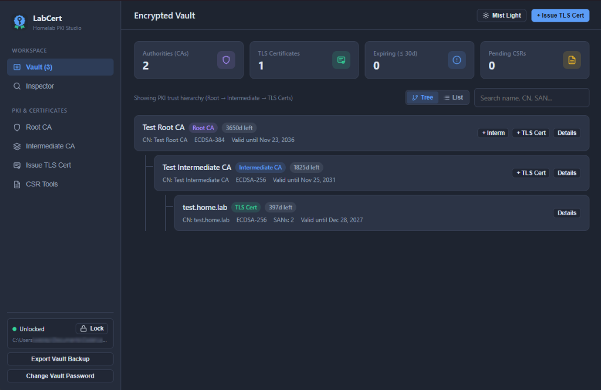
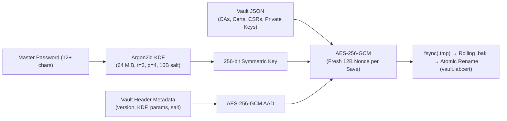

<div align="center">
  
  <h1>LabCert</h1>
  <p><strong>A sleek, cross-platform PKI &amp; TLS certificate studio for homelabs — powered by Go &amp; Wails v2.</strong></p>

  <p>
    
    
    
    
    
  </p>
</div>

<p align="center">
  
</p>

---

## Highlights

| Area | Capabilities |
| :--- | :--- |
| **PKI Hierarchy** | Create self-signed **Root CAs**, **Intermediate CAs** (with automatic Subject DN inheritance), and end-entity **TLS certificates** with `PathLen`, `KeyUsage`, and `ExtendedKeyUsage`. |
| **Modern Cryptography** | Supports `ECDSA P-256`, `ECDSA P-384`, `Ed25519`, and `RSA 2048/3072/4096` with 128-bit random serials and RFC-compliant key usage (automatically omits `KeyEncipherment` on ECDSA/Ed25519). |
| **Smart SAN Builder** | Interactive chip input that auto-classifies DNS names (including wildcards like `*.home.arpa`) and IPv4/IPv6 addresses with inline validation and quick HTTPS / Wildcard / mTLS presets. |
| **CSR & Revocation** | Generate PKCS#10 CSRs, review external or stored CSRs in a mandatory preview modal before signing, revoke certificates, and export signed **X.509 v2 CRLs** (`.crl.pem`). |
| **Inspector & Exports** | Inspect PEM certificates/CSRs (with trust verification against your vault CAs) and export `.crt`, `.fullchain.pem`, `.key`, `.csr`, or password-protected **PKCS#12 (`.p12` / `.pfx`)** bundles. |
| **Modern Dual-Theme UI** | Switch between **Slate Dark** and **Mist Light** themes, toggle between **Tree View** (`Root → Intermediate → TLS Certs`) and **List View**, and inspect items in a slide-over drawer. |

---

## Security & Crypto Architecture

LabCert keeps all private keys encrypted at rest inside a single portable `*.labcert` vault file and guards sensitive operations in memory and at the UI boundary.



- **Authenticated Encryption (v2 Vault Format)**: Header parameters are bound as AES-GCM Additional Authenticated Data (AAD) and validated against safe bounds before key derivation to prevent header tampering or resource exhaustion.
- **Overwrite Protection & Backups**: Creating a new vault refuses to overwrite an existing file. Every save `fsync`s to a temporary file and maintains a rolling `.bak` copy, plus an in-app **Export Vault Backup** button.
- **Session & Secret Hygiene**:
  - **10-minute idle auto-lock** clears decrypted keys from memory.
  - **Master password re-verification** is required before revealing/copying/exporting private keys, deleting CAs, or changing the vault password.
  - **30-second clipboard auto-clear** when copying private keys, and 30-second auto-hide in the drawer.
  - **Strict Content-Security-Policy (CSP)** and 1 MiB input bounds on PEM files and inspector input.

---

## Building from Source

> [!NOTE]
> **Node.js and Go are build-time dependencies only.** `wails build` bundles the compiled TypeScript frontend directly into the Go binary via `embed.FS`, so end users running the compiled executable do **not** need Node.js or Go installed.

<details>
<summary><strong>Prerequisites (Windows, macOS, Linux)</strong></summary>

- **Go** `1.23+`
- **Node.js** `20+` and `npm`
- **Wails CLI v2**:
  ```bash
  go install github.com/wailsapp/wails/v2/cmd/wails@latest
  ```
- **OS Webview Runtime**:
  - **Windows**: Microsoft Edge WebView2 Runtime (pre-installed on Windows 11 and most Windows 10 systems)
  - **macOS**: Xcode Command Line Tools (WebKit is built in)
  - **Linux**: `libgtk-3-dev` and `libwebkit2gtk-4.0-dev` (or `webkit2gtk-4.1` depending on distro)

Verify your toolchain before building:
```bash
wails doctor
```

</details>

### Build & Test Commands

```bash
# Run Go PKI & encrypted vault unit tests
go test -v ./...

# Live development with frontend hot-reload
wails dev

# Production single-binary build (outputs to build/bin/LabCert[.exe])
wails build
```

---

## Usage Guide

1. **Open or Create a Vault**
   - LabCert defaults to **Open Vault** and remembers your last selected vault path.
   - On first run, switch to **Create New Vault**, pick a path (defaults to your OS user config directory under `LabCert/vault.labcert`), and set a master password (12+ characters).
2. **Create a Root CA**
   - Open **Root CA** in the sidebar, enter a Common Name (e.g., `Homelab Root CA`), select a key algorithm (`ECDSA P-384` or `RSA 4096-bit`), and generate.
3. **Create an Intermediate CA** *(Recommended)*
   - Click **+ Interm** directly on your Root CA in the Vault Tree View (or open **Intermediate CA**). Subject details (`O`, `OU`, `C`, `ST`, `L`) are inherited automatically.
4. **Issue TLS Certificates**
   - Click **+ TLS Cert** on your Intermediate CA, enter a Common Name (e.g., `proxmox.home.arpa`), add DNS/IP SANs using the chip builder, and issue (defaults to `397` days for modern TLS compatibility).
5. **Export for Your Homelab**
   - Click any entry in the Vault to open the slide-over drawer, switch to the **Export** tab, and save `.crt`, `.fullchain.pem`, `.key`, `.p12`/`.pfx`, or `.crl.pem` files for Nginx, Traefik, Caddy, Proxmox, or TrueNAS.

> [!TIP]
> Trust only your **Root CA** (`.crt`) on your client devices, and serve the **Full Chain** (`.fullchain.pem`) + **Private Key** (`.key`) from your homelab reverse proxy or services.
